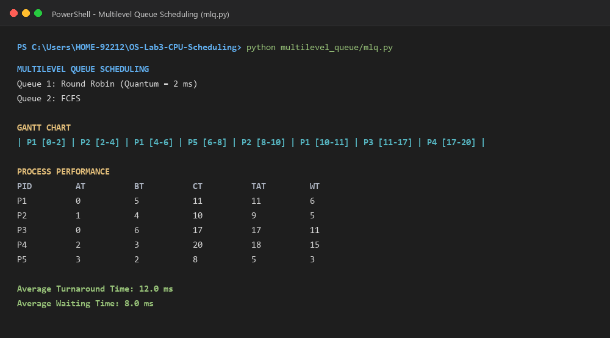
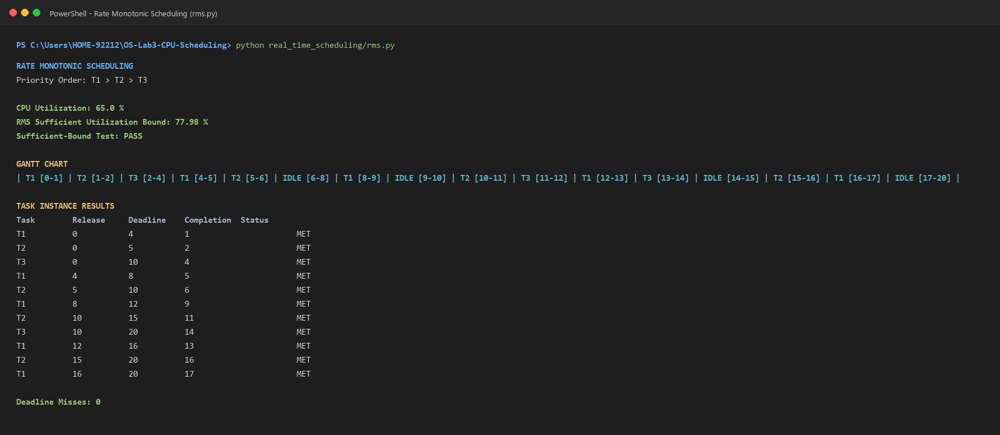
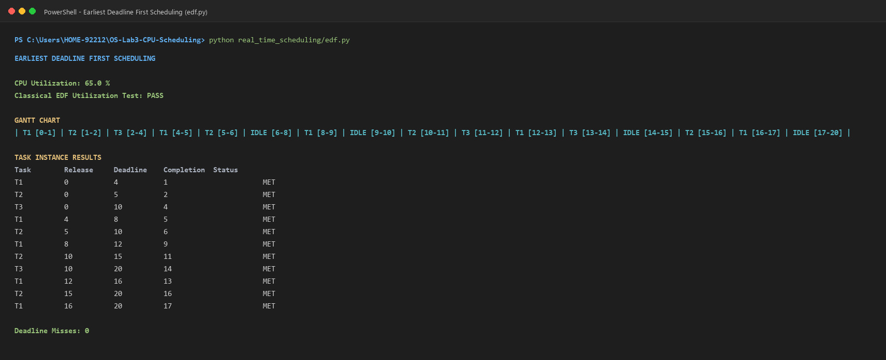

# OS Laboratory Activity 3
## Multilevel Queue and Real-Time CPU Scheduling

### Student Information
- **Name:** Michael Cadiz
- **Course & Section:** BCA 2nd Year
- **Subject:** BCA151 Operating Systems Lab
- **Date Submitted:** November 14, 2026
- **Repository:** [https://github.com/mccdz1/OS-Lab3-CPU-Scheduling](https://github.com/mccdz1/OS-Lab3-CPU-Scheduling)

---

## I. Introduction
In modern computing, process scheduling plays a foundational role in managing how tasks utilize central processing resources. General-purpose operating systems balance interactive user responsiveness with long-running background computation, whereas real-time operating systems (RTOS) must guarantee predictable, deterministic execution to satisfy strict timing and deadline constraints.

This laboratory activity focuses on the practical implementation, execution simulation, and behavioral analysis of three essential CPU scheduling strategies:
1. **Multilevel Queue (MLQ) Scheduling**: Classifying processes into hierarchical priority queues with tailored scheduling policies (Round Robin for interactive tasks and First-Come, First-Served for batch tasks).
2. **Rate Monotonic Scheduling (RMS)**: A static, fixed-priority preemptive scheduling paradigm designed for periodic real-time tasks where task priorities are inversely proportional to their cycle periods.
3. **Earliest Deadline First (EDF)**: A dynamic-priority preemptive scheduling algorithm that assigns the highest processing priority to ready task instances with the nearest absolute deadlines.

Using Python simulations configured at a discrete 1 ms time granularity, this laboratory analyzes execution timelines using Gantt charts, computes turnaround times, waiting times, processor utilization, and monitors deadline compliance.

---

## II. Objectives
The objectives of this laboratory activity are:
1. Explain the underlying mechanics and trade-offs of Multilevel Queue, Rate Monotonic, and Earliest Deadline First scheduling algorithms.
2. Implement an MLQ scheduler employing Round Robin (time quantum $q = 2\text{ ms}$) for Queue 1 and First-Come, First-Served (FCFS) for Queue 2 with strict preemption.
3. Implement preemptive Rate Monotonic Scheduling (RMS) and dynamic Earliest Deadline First (EDF) simulations in Python.
4. Construct and interpret textual Gantt charts illustrating process and periodic task execution timelines.
5. Calculate and analyze key performance metrics, including CPU utilization ($U$), average turnaround time ($TAT$), average waiting time ($WT$), and task deadline compliance.
6. Manage and document all laboratory outputs, source code, and execution evidence within a structured public GitHub repository.

---

## III. Scheduling Algorithms Overview

### 1. Multilevel Queue (MLQ) Scheduling
Multilevel Queue partitions the ready queue into multiple distinct sub-queues based on process attributes such as priority, interactive nature, or memory requirements.
- **Queue 1 (High Priority / Interactive)**: Governed by Round Robin (RR) with a time quantum $q = 2\text{ ms}$ to guarantee low latency and frequent CPU turns for interactive workloads.
- **Queue 2 (Low Priority / Batch)**: Governed by First-Come, First-Served (FCFS) for throughput-oriented batch computations.
- **Preemption Rule**: Queue 1 processes possess absolute priority over Queue 2. Any arrival in Queue 1 instantly preempts an executing Queue 2 process, which resumes later from where it was suspended.

### 2. Rate Monotonic Scheduling (RMS)
RMS is the optimal fixed-priority preemptive algorithm for periodic, independent tasks on uniprocessors with deadlines equal to periods ($D_i = T_i$).
- **Priority Assignment**: Shorter period = higher priority. Priority remains constant for all instances across the entire operational timeline.
- **Schedulability Bound**: Liu and Layland established that a set of $n$ periodic tasks is guaranteed schedulable if total processor utilization satisfies:
  $$U = \sum_{i=1}^n \frac{C_i}{T_i} \le n(2^{1/n} - 1)$$
  For $n = 3$, $U_{\text{bound}} = 3(2^{1/3} - 1) \approx 77.98\%$.

### 3. Earliest Deadline First (EDF)
EDF is an optimal dynamic-priority preemptive algorithm for real-time uniprocessor systems.
- **Priority Assignment**: The task instance with the earliest absolute deadline ($d_{i,k} = r_{i,k} + D_i$) receives the highest execution priority.
- **Schedulability Criterion**: When relative deadlines equal periods ($D_i = T_i$), a task set is schedulable under EDF if and only if total CPU utilization does not exceed 100%:
  $$U = \sum_{i=1}^n \frac{C_i}{T_i} \le 1.0 \quad (100\%)$$

---

## IV. Program Implementation

### File and Folder Structure
```text
OS-Lab3-CPU-Scheduling/
├── README.md
├── multilevel_queue/
│   └── mlq.py
├── real_time_scheduling/
│   ├── rms.py
│   └── edf.py
├── outputs/
│   ├── mlq_output.txt
│   ├── rms_output.txt
│   └── edf_output.txt
└── screenshots/
    ├── mlq_screenshot.png
    ├── rms_screenshot.png
    └── edf_screenshot.png
```

### Implementation Details
- **`multilevel_queue/mlq.py`**:
  Uses two standard Python double-ended queues (`collections.deque`), `q1` and `q2`. Time advances in 1 ms steps. At each tick, incoming processes are enqueued. The scheduler selects `q1` whenever non-empty, applying a 2 ms quantum. If `q1` is empty, `q2` runs its head process under FCFS until completion or until preempted by an arrival in `q1`.
- **`real_time_scheduling/rms.py`**:
  Generates all periodic task releases over the simulation window ($[0, 20)\text{ ms}$). Ready task instances are filtered at each millisecond, and the job associated with the shortest period $T$ is selected for execution.
- **`real_time_scheduling/edf.py`**:
  Dynamically evaluates all ready jobs at every 1 ms time unit and assigns CPU ownership to the job with the minimal absolute deadline ($r + D$). Secondary tie-breakers resolve equal deadlines using release time and task ID.

---

## V. Test Data

### 1. Multilevel Queue (MLQ) Dataset
| Process | Arrival Time ($AT$) | Burst Time ($BT$) | Assigned Queue | Queue Policy | Priority Level |
| :---: | :---: | :---: | :---: | :---: | :---: |
| **P1** | 0 ms | 5 ms | Queue 1 | Round Robin ($q = 2\text{ ms}$) | High |
| **P2** | 1 ms | 4 ms | Queue 1 | Round Robin ($q = 2\text{ ms}$) | High |
| **P3** | 0 ms | 6 ms | Queue 2 | FCFS | Low |
| **P4** | 2 ms | 3 ms | Queue 2 | FCFS | Low |
| **P5** | 3 ms | 2 ms | Queue 1 | Round Robin ($q = 2\text{ ms}$) | High |

### 2. Real-Time Tasks Dataset (RMS and EDF)
Simulation Horizon: **20 ms**; All tasks released initially at **$t = 0\text{ ms}$**; Relative Deadlines equal Periods ($D_i = T_i$).

| Task | Execution Time ($C_i$) | Period ($T_i$) | Relative Deadline ($D_i$) | RMS Priority | Individual Utilization ($U_i$) |
| :---: | :---: | :---: | :---: | :---: | :---: |
| **T1** | 1 ms | 4 ms | 4 ms | Highest (Period = 4) | $1 / 4 = 25.0\%$ |
| **T2** | 1 ms | 5 ms | 5 ms | Second (Period = 5) | $1 / 5 = 20.0\%$ |
| **T3** | 2 ms | 10 ms | 10 ms | Lowest (Period = 10) | $2 / 10 = 20.0\%$ |

$$\text{Total CPU Utilization } U = 0.25 + 0.20 + 0.20 = 0.65 = 65.0\%$$

---

## VI. Results and Discussion

### 1. Multilevel Queue (MLQ) Simulation Results

#### Output Execution Log
```text
MULTILEVEL QUEUE SCHEDULING
Queue 1: Round Robin (Quantum = 2 ms)
Queue 2: FCFS

GANTT CHART
| P1 [0-2] | P2 [2-4] | P1 [4-6] | P5 [6-8] | P2 [8-10] | P1 [10-11] | P3 [11-17] | P4 [17-20] |

PROCESS PERFORMANCE
PID	AT	BT	CT	TAT	WT
P1	0	5	11	11	6
P2	1	4	10	9	5
P3	0	6	17	17	11
P4	2	3	20	18	15
P5	3	2	8	5	3

Average Turnaround Time: 12.0 ms
Average Waiting Time: 8.0 ms
```

#### Process Timeline Analysis
- **$t = 0-2$ ms**: $P_1$ (Queue 1) executes for its quantum of 2 ms (remaining: 3 ms).
- **$t = 2-4$ ms**: $P_2$ (arrived at $t=1$) runs for 2 ms (remaining: 2 ms). Meanwhile, $P_4$ arrives at $t=2$ and $P_5$ at $t=3$.
- **$t = 4-6$ ms**: $P_1$ runs its second slice of 2 ms (remaining: 1 ms).
- **$t = 6-8$ ms**: $P_5$ executes for 2 ms and finishes completely at $t = 8\text{ ms}$.
- **$t = 8-10$ ms**: $P_2$ executes its remaining 2 ms and finishes at $t = 10\text{ ms}$.
- **$t = 10-11$ ms**: $P_1$ completes its final 1 ms burst at $t = 11\text{ ms}$.
- **$t = 11-17$ ms**: Queue 1 is now empty. $P_3$ (which arrived at $t=0$ in Queue 2) finally gains the CPU and runs under FCFS for 6 ms, completing at $t = 17\text{ ms}$.
- **$t = 17-20$ ms**: $P_4$ runs under FCFS for 3 ms, finishing at $t = 20\text{ ms}$.

#### Execution Screenshot


---

### 2. Rate Monotonic Scheduling (RMS) Simulation Results

#### Output Execution Log
```text
RATE MONOTONIC SCHEDULING
Priority Order: T1 > T2 > T3

CPU Utilization: 65.0 %
RMS Sufficient Utilization Bound: 77.98 %
Sufficient-Bound Test: PASS

GANTT CHART
| T1 [0-1] | T2 [1-2] | T3 [2-4] | T1 [4-5] | T2 [5-6] | IDLE [6-8] | T1 [8-9] | IDLE [9-10] | T2 [10-11] | T3 [11-12] | T1 [12-13] | T3 [13-14] | IDLE [14-15] | T2 [15-16] | T1 [16-17] | IDLE [17-20] |

TASK INSTANCE RESULTS
Task	Release	Deadline	Completion	Status
T1	0	4	1		MET
T2	0	5	2		MET
T3	0	10	4		MET
T1	4	8	5		MET
T2	5	10	6		MET
T1	8	12	9		MET
T2	10	15	11		MET
T3	10	20	14		MET
T1	12	16	13		MET
T2	15	20	16		MET
T1	16	20	17		MET

Deadline Misses: 0
```

#### RMS Analysis
- **Schedulability Check**: Total utilization $U = 65.0\%$ is below the Liu & Layland sufficient bound ($77.98\%$). Thus, all tasks are theoretically guaranteed to meet their deadlines, which is confirmed by the simulation ($0$ deadline misses).
- **Preemption Demonstration ($t = 11-14$ ms)**:
  At $t = 10\text{ ms}$, both $T_2$ and $T_3$ release. $T_2$ (period 5) has higher priority than $T_3$ (period 10), so $T_2$ runs from $10$ to $11$.
  At $t = 11\text{ ms}$, $T_3$ starts running.
  At $t = 12\text{ ms}$, $T_1$ releases (period 4). Since $T_1$ has strictly higher priority than $T_3$, $T_1$ **preempts** $T_3$ at $t = 12\text{ ms}$!
  $T_1$ finishes at $t = 13\text{ ms}$, after which $T_3$ resumes and completes its remaining 1 ms at $t = 14\text{ ms}$, well ahead of its deadline ($t = 20\text{ ms}$).

#### Execution Screenshot


---

### 3. Earliest Deadline First (EDF) Simulation Results

#### Output Execution Log
```text
EARLIEST DEADLINE FIRST SCHEDULING

CPU Utilization: 65.0 %
Classical EDF Utilization Test: PASS

GANTT CHART
| T1 [0-1] | T2 [1-2] | T3 [2-4] | T1 [4-5] | T2 [5-6] | IDLE [6-8] | T1 [8-9] | IDLE [9-10] | T2 [10-11] | T3 [11-12] | T1 [12-13] | T3 [13-14] | IDLE [14-15] | T2 [15-16] | T1 [16-17] | IDLE [17-20] |

TASK INSTANCE RESULTS
Task	Release	Deadline	Completion	Status
T1	0	4	1		MET
T2	0	5	2		MET
T3	0	10	4		MET
T1	4	8	5		MET
T2	5	10	6		MET
T1	8	12	9		MET
T2	10	15	11		MET
T3	10	20	14		MET
T1	12	16	13		MET
T2	15	20	16		MET
T1	16	20	17		MET

Deadline Misses: 0
```

#### EDF Analysis
- **Schedulability Check**: Under classical uniprocessor conditions with $D_i = T_i$, $U = 65.0\% \le 100\%$ guarantees schedulability.
- **Dynamic Priority Verification**: For this test workload, the relative deadline ordering matches the period ordering at concurrent releases, producing an identical execution sequence to RMS while dynamically evaluating absolute deadlines at every scheduling tick. All 11 task instances completed with status **MET**.

#### Execution Screenshot


---

## VII. Algorithm Comparison

| Criteria | Multilevel Queue (MLQ) | Rate Monotonic Scheduling (RMS) | Earliest Deadline First (EDF) |
| :--- | :--- | :--- | :--- |
| **Scheduling Basis** | Queue priority & process category | Task cycle period ($T_i$) | Absolute deadline ($d_i = r_i + D_i$) |
| **Priority Assignment** | Fixed queue priority | Static / Fixed task priority (shorter period = higher) | Dynamic task priority (earliest deadline = highest) |
| **Scheduling Type** | Preemptive across queues; policy-dependent within queue | Preemptive | Preemptive |
| **Main Application** | General-purpose OS process classification (interactive vs. batch) | Periodic hard real-time embedded systems | Deadline-critical real-time systems |
| **Deadline Monitoring**| Not inherent (optimizes responsiveness and throughput) | Yes (inherent timing validation against period) | Yes (explicit deadline-driven dispatching) |
| **Processor Schedulability Limit** | N/A (subject to starvation in lower queues without aging) | $U \le n(2^{1/n} - 1)$ ($\approx 69.3\%$ asymptotic bound) | $U \le 1.0$ ($100\%$ theoretical utilization) |
| **Run-time Overhead** | Low (simple queue structures) | Minimal (fixed integer priority comparisons) | Moderate (dynamic deadline tracking and sorting) |

---

## VIII. Conclusion
Through this laboratory activity, the practical operation and mathematical principles governing both general-purpose and real-time CPU scheduling were thoroughly analyzed and verified:
1. **Multilevel Queue Scheduling** effectively segregates processes based on behavioral profiles. Using Round Robin for Queue 1 provides bounded latency for interactive tasks, while FCFS maximizes execution efficiency for batch tasks. However, the simulation clearly highlighted that without an aging mechanism (as in MLFQ), lower-priority queues can suffer prolonged waiting times ($WT = 11\text{ ms}$ for $P_3$ and $15\text{ ms}$ for $P_4$).
2. **Rate Monotonic Scheduling (RMS)** proves that static priority assignment based on task period offers simple, robust, and deterministic scheduling for periodic real-time applications. The simulation demonstrated successful preemption of lower-priority tasks when higher-frequency tasks arrive.
3. **Earliest Deadline First (EDF)** demonstrates the power of dynamic priority assignment based on absolute deadlines, offering the theoretical capability to achieve up to 100% processor utilization without missing deadlines.
4. Implementing these scheduling policies in Python provided hands-on competency in tracking time-stepped state machines, managing preemption, recording Gantt execution intervals, and documenting software repositories systematically on GitHub.

---

## IX. Answers to Guide Questions

### 1. What is the main difference between Multilevel Queue and Multilevel Feedback Queue scheduling?
The fundamental difference lies in **process mobility**:
- In **Multilevel Queue (MLQ)**, processes are permanently assigned to a specific queue upon creation based on static attributes (e.g., interactive vs. batch). A process cannot move between queues during its lifecycle.
- In **Multilevel Feedback Queue (MLFQ)**, processes can dynamically transition between queues based on their runtime execution behavior. A process that uses excessive CPU time in a high-priority queue is demoted to a lower-priority queue, while I/O-bound processes or processes that experience long waiting times can be promoted to higher queues through an aging mechanism to prevent starvation.

### 2. Why does MLQ use different scheduling algorithms for different process queues?
Different process categories have conflicting performance objectives:
- **Interactive / Foreground processes** (Queue 1) require immediate user responsiveness, low latency, and predictable turnaround times. **Round Robin (RR)** is chosen because its time slicing guarantees that every interactive process receives regular CPU access without prolonged waiting.
- **Batch / Background processes** (Queue 2) are non-interactive and computationally intensive. Their primary metric is overall throughput rather than response time. **First-Come, First-Served (FCFS)** is chosen because it minimizes unnecessary context switching overhead, enabling batch jobs to run efficiently to completion once CPU time is allocated.

### 3. How does RMS determine which task receives the CPU first?
Rate Monotonic Scheduling assigns static priorities inversely proportional to task periods ($T_i$). The task with the **shortest cycle period** is assigned the **highest priority**. At any scheduling decision point, the scheduler inspects the ready tasks and selects the task with the shortest period. In our simulation, because $T_1 = 4\text{ ms}$, $T_2 = 5\text{ ms}$, and $T_3 = 10\text{ ms}$, the static priority ordering is $T_1 > T_2 > T_3$.

### 4. Why is RMS considered a fixed-priority scheduling algorithm?
RMS is categorized as fixed-priority (or static-priority) because the priority of each task is assigned **offline before runtime** based strictly on its period $T_i$, and this priority never changes. Every job instance released by a given task inherits the exact same priority regardless of how close it is to its deadline, how much execution time remains, or current system workload.

### 5. How does EDF determine which task should execute next?
Earliest Deadline First determines execution order by inspecting the **absolute deadline** of every currently ready task instance ($d_{i,k} = r_{i,k} + D_i$, where $r_{i,k}$ is the release time and $D_i$ is the relative deadline). At every scheduling point, the scheduler selects the ready job with the smallest (earliest) absolute deadline value. Ties are broken using deterministic secondary criteria such as earlier release time or numerical task ID.

### 6. Why is EDF considered a dynamic-priority scheduling algorithm?
EDF is dynamic because a task's scheduling priority is not fixed; instead, it is re-evaluated dynamically at runtime for each individual job release based on its absolute deadline. Two jobs of the same task will have different absolute deadlines at different release cycles, meaning their priority relative to other tasks in the system continuously shifts over time.

### 7. What happens when a newly released task has an earlier deadline than the currently running task under EDF?
Because EDF is preemptive, when a newly released task arrives with an absolute deadline that is strictly earlier than that of the currently running task, the scheduler immediately **preempts** the running task. The preempted task is returned to the ready queue with its remaining execution time preserved, and the CPU is immediately context-switched to the newly arrived task.

### 8. Why is CPU utilization important in real-time scheduling?
CPU utilization ($U = \sum \frac{C_i}{T_i}$) quantifies the proportion of processing capacity demanded by the task set. It is critical because:
1. It provides an immediate mathematical feasibility test: if $U > 1.0$ (100%) on a uniprocessor, no algorithm can schedule the tasks without missing deadlines.
2. For RMS, it determines schedulability against the Liu and Layland bound ($U \le n(2^{1/n}-1)$); satisfying this bound provides mathematical guarantee against deadline misses.
3. For EDF, it serves as an exact necessary and sufficient condition ($U \le 1.0$) for schedulability under standard assumptions.
4. It helps system designers determine spare CPU capacity available for aperiodic tasks, operating system overhead, or future application expansion.

### 9. Can a task set with CPU utilization below 100% still miss a deadline? Explain the conditions under which this may happen.
Yes. A task set with $U < 100\%$ can still miss deadlines under several realistic circumstances:
1. **RMS Bound Exceeded**: Under fixed-priority RMS, a task set with utilization between the Liu-Layland bound ($\approx 69.3\% - 77.98\%$) and $100\%$ may experience deadline misses if task phasing and periods do not align harmonically.
2. **Constrained Deadlines ($D_i < T_i$)**: If relative deadlines are shorter than task periods, the task density ($\sum \frac{C_i}{D_i}$) can exceed available capacity during transient intervals even if average utilization $U = \sum \frac{C_i}{T_i} < 1.0$.
3. **Execution Time Overruns**: If tasks exceed their estimated worst-case execution time ($C_i$) due to complex algorithmic branching, cache misses, or pipeline stalls.
4. **Blocking and Priority Inversion**: When tasks share mutually exclusive resources (mutexes/locks) and higher-priority tasks are blocked waiting for lower-priority tasks.
5. **Context Switch and Hardware Overhead**: Real-world operating systems incur context switching penalties, interrupt handling delays, and timer jitter that consume CPU cycles not captured in theoretical models.

### 10. Which algorithm would you recommend for periodic real-time tasks, RMS or EDF? Justify your answer.
The recommendation depends on the system requirements and hardware architecture:
- **Recommend EDF when CPU capacity is tightly constrained and maximum processor utilization is paramount**: EDF is theoretically optimal on uniprocessors and can utilize up to 100% of the CPU without missing deadlines, compared to RMS's worst-case limit of $\approx 69.3\%$. It also naturally handles varying periods and dynamic deadlines without requiring re-indexing.
- **Recommend RMS for mission-critical, hard real-time, safety-critical, and resource-constrained embedded systems**: RMS is exceptionally simple to implement, operates with minimal computational overhead (fixed integer priority comparisons), and is natively supported by virtually all real-time operating systems (FreeRTOS, VxWorks, RTEMS). Crucially, in overload situations, RMS exhibits **predictable degradation** (only lower-priority tasks miss deadlines, leaving safety-critical high-frequency tasks intact), whereas overloaded EDF can suffer from a catastrophic "domino effect" where one late task causes all subsequent tasks to miss deadlines.

---

## X. How to Run the Programs

Ensure you have Python 3 installed. Navigate to the repository root directory in your terminal and execute:

### Run Multilevel Queue Simulation
```bash
python multilevel_queue/mlq.py
```

### Run Rate Monotonic Scheduling Simulation
```bash
python real_time_scheduling/rms.py
```

### Run Earliest Deadline First Simulation
```bash
python real_time_scheduling/edf.py
```
